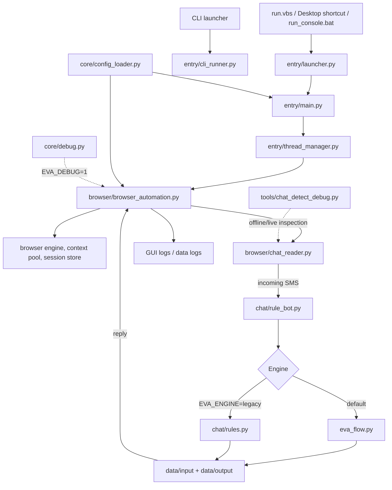

# EVA Bot — Project Map

EVA Bot-এর প্রধান পথ হলো: **Launcher → GUI/CLI → Worker/Browser → SMS detector → Reply engine → TXT data → Send + logs**।

Dashboard-এর page/control ও তাদের file mapping-এর জন্য [DASHBOARD_MAP.md](DASHBOARD_MAP.md) দেখুন.

## 1. Architecture flow



## 2. Directory map

```text
entry/       Windowless launcher, GUI, CLI, thread orchestration, project paths
browser/     Browser lifecycle, CDP launcher, session store, context pool, chat reader
chat/        ChatRuleBot, default/legacy reply logic, classifiers, database loader
core/        Config loading, debug helpers, engine bridge, account/resource tools
config/      Intent and engine tuning configuration
data/
  config.json        Runtime/performance/session settings
  input/             Incoming-message triggers/categories
  output/            Reply pools/categories (editable text files)
  local_db/          Local reply and rule datasets
docs/        Architecture, task state, install and troubleshooting notes
tools/       Live chat REPL, detector debugger, coverage utilities
tests/       Runtime-debug unit tests and DOM fixtures
```

## 3. Main runtime sequence

1. **GUI startup:** `install.bat` creates the Desktop shortcut (`.venv/Scripts/pythonw.exe -m entry.launcher`); `run.vbs` selects an interpreter and calls the same `entry.launcher`. The wrapper imports `entry.main`, logs windowless startup failures to `data/logs/gui_console.log`, and shows a Windows notice. `run_console.bat` uses the venv's `python.exe` and prints tracebacks. The standalone CLI remains `entry/cli_runner.py`.
2. **Dashboard CDP capture:** the Dashboard panel in `entry/main.py` calls `browser/cdp_capture_launcher.py`, which discovers/selects a browser and launches a temporary-profile Chrome/Chromium/Edge with loopback-only CDP; `capture.py` writes the redacted trace. This does not launch bot automation.
3. **Configure:** `core/config_loader.py` loads `data/config.json`; `config/eva_config.json` contains intent tuning.
4. **Start workers:** `entry/thread_manager.py` coordinates workers and browser sessions.
5. **Read chat:** `browser/browser_automation.py` polls the page; `browser/chat_reader.py` extracts and fingerprints messages so the bot does not answer its own echoes.
6. **Choose reply:** `chat/rule_bot.py` uses the default diagram flow in `eva_flow.py`; set `EVA_ENGINE=legacy` to use `chat/rules.py`.
7. **Load text:** reply categories come from matching `data/input/<category>.txt` and `data/output/<category>.txt` files, with additional datasets in `data/local_db/`.
8. **Send and observe:** the browser worker sends the reply, updates chat statistics, and writes diagnostics to the GUI/log outputs.

## 4. Debug and test map

- `EVA_DEBUG=1` — adds extractor/engine timings and bounded, redacted exception tracebacks.
- `EVA_DUMP_CHAT_DOM=1` — saves a page snapshot under `logs/` when detection cannot read messages. Review/redact snapshots before sharing.
- Dashboard **Debug Mode (manual chat)** keeps one visible browser/account open for user-driven chat (no bot chat loop, account rotation, or session auto-save) and writes a bounded redacted capture under `capture/`: combined `debug-api.txt`, plus `websocket.jsonl` and `http-api.jsonl`. `EVA_SOCKET_TRACE=1` enables the same metadata-only recorder during a normal visible bot run. It records event/route/status/timing/schema metadata, not raw values or chat text. See [WEBSOCKET_ANALYSIS.md](WEBSOCKET_ANALYSIS.md).
- `tools/chat_detect_debug.py --html <saved-page.html>` — inspect saved markup without logging in; `--url <url>` uses a live browser.
- `python tests/test_smooth_debug.py` — tests runtime debug helpers and polling bounds.
- `python tests/test_socket_trace.py` — tests WebSocket/API summaries, shared-file output, and confirms private values are not persisted.
- `python -m unittest tests.test_launcher tests.test_cdp_capture_launcher -v` — tests startup diagnostics and verifies every Dashboard CDP helper import exists.
- `python test_chat_detect.py` — tests message detection and browser integration; optional DOM fixtures need Node.js + jsdom.
- `python test_flow.py`, `python test_live.py`, `python test_fuzz.py`, `python test_matcher.py` — reply-flow and data checks.

## 5. Sensitive runtime data

Saved account sessions, browser profiles, credentials and runtime logs are local-only. Do not commit or share session files, cookies, or raw DOM/log dumps; the repository `.gitignore` excludes these artifacts. The files under `capture/` omit secret values and chat bodies but still reveal API routes/event names, so review before sharing.
